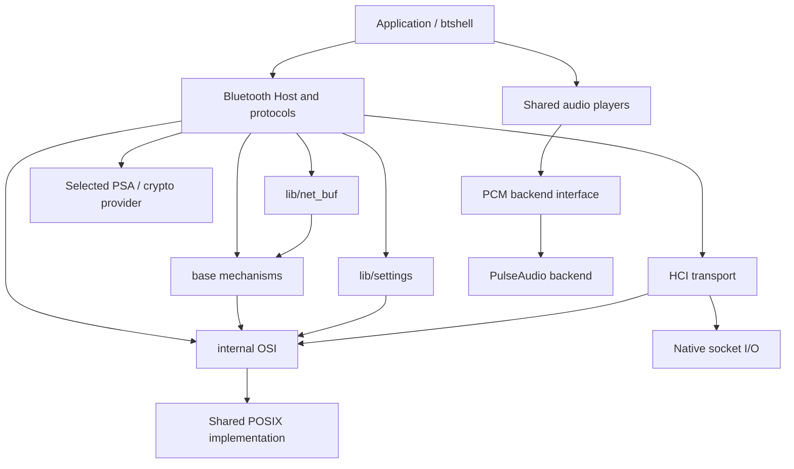

<!--
/****************************************************************************
 *  Copyright (C) 2026 EmBT contributors
 *
 * Licensed under the Apache License, Version 2.0 (the "License");
 * you may not use this file except in compliance with the License.
 * You may obtain a copy of the License at
 *
 *      http://www.apache.org/licenses/LICENSE-2.0
 *
 * Unless required by applicable law or agreed to in writing, software
 * distributed under the License is distributed on an "AS IS" BASIS,
 * WITHOUT WARRANTIES OR CONDITIONS OF ANY KIND, either express or implied.
 * See the License for the specific language governing permissions and
 * limitations under the License.
 ***************************************************************************/
-->

# 当前架构

本文描述当前本地实现，代码 SHA 和验证状态见 [STATUS](STATUS.md)。
首期是 Linux 上的 Bluetooth 4.2 基础 LE 与 BR/EDR Host 移植。
Mesh/LE Audio 等源码保留，并有编译与部分组件测试；其运行范围单独标明。
当前保留多线程和同步 HCI 调用，单线程与全异步属于后续任务。

## 模块与依赖

| 目录 | 职责 |
| --- | --- |
| `include/embt/` | 协议、buffer、settings/audio/driver 等接口 |
| `include/embt/base/`、`include/embt/osi/` | 按功能组织的基础工具/机制与系统接口，类型和操作同头 |
| `bluetooth/` | Host、Classic、common、crypto、services、Mesh/Audio 及协议 shell |
| `lib/` | net_buf、settings、UUID/编码工具和共享音频播放组件 |
| `base/` | atomic、queue/FIFO/LIFO/slab、work、时间、日志、断言和基础初始化 |
| `osdep/` | 内部 `osi_*` 系统接口、类型与 POSIX 实现 |
| `drivers/` | HCI socket transport 与音频多后端实现 |
| `apps/btshell/` | 命令行入口及共享 runner |
| `third_party/` | 真实密码库、codec、cmocka/FFF 的接入 |
| `tools/`、`config/`、`test/` | 构建/配置工具、功能片段、单元及集成验证 |

这是主要调用关系，不表示所有算法只允许通过一条固定链访问工具。
OSI 不管理 Bluetooth 状态或反向依赖 queue/work/net_buf。
原 Controller、内核、设备树与 west 不作为运行或构建依赖。

## 头文件与构建边界

应用链接 `EmBT::embt`，协议接口使用 `<embt/...>`，基础依赖使用 `<embt/base/...>` / `<embt/osi/...>`。
头文件集中在根 include，类型和操作同属功能头，不再有 sys/types 目录或独立类型聚合。
共享 include 使基础头可见，但 base/OSI 操作仍遵守内部接口合同；存储可见不授权应用直接
操作锁/引用计数，也不表示布局与平台无关。backend-only helper 留在实现目录。

各组件以 OBJECT target 管理源码，最终聚合为 `libembt.a`。`embt_config` 对项目和应用
传递同一生成配置头；三方源码不获得 EmBT 的强制配置 include。
公开 PSA 的 provider 传递仍在 [待办](STATUS.md)；无消费者且缺少实现的 div64 头已移除。
不能因共享 include 就把 backend-only helper 或未验证 API 当成正式应用能力。

## 执行上下文

| 上下文 | 当前用途 |
| --- | --- |
| HCI receiver | 读取实际 socket、分帧、分配 RX buffer，调用接收入口 |
| Host RX workqueue | 处理普通 HCI 事件/数据及提交到该队列的协议 work |
| Host TX processor | 按配置在专用 workqueue 或 system workqueue 中推进发送 |
| system workqueue | 默认基础 work 执行器 |
| timeout dispatcher | 按单调 deadline 把到期 delayed work 投递到所属队列 |
| 可选 long/notify/Mesh/codec/audio worker | 对应模块启用时运行，不属于统一单线程循环 |

接收入口先同步处理 priority event，再把普通输入投递到 RX 队列。
同步 HCI caller 等待完成通知；该等待不是自动转换为异步接口。
Linux 使用默认 pthread 调度/栈属性，没有 Zephyr cooperative 调度保证。
实际锁、work 状态机和对象所有权仍然必要；当前实现不承诺所有 API 可任意跨线程调用。

## 初始化与启停

`bt_stack_init()` 初始化 base、Host 锁/credit/pool 和启用的 worker/模块 storage，
按明确依赖和配置顺序启动 worker。它不等于 Controller 已初始化，也不等于所有业务功能
已开始运行。静态存储不代替 runtime init。

btshell runner 先配置 transport、初始化 stack 和启用的 settings，再建立 shell storage
与命令表；音频后端按配置注册。启动 CLI 后蓝牙仍未 enable。
`bt_enable()` / shell `bt init` 打开 HCI 并执行 Controller/Host 初始化；
异步成功以 ready callback 为准。`bt disable` 负责蓝牙停止；`quit` 不隐式执行 HCI teardown。

初始化失败应撤销已建立的依赖；停止时先阻断输入与重提交，再完成/取消 work、回收引用，
最后销毁对象。已确认的 RFCOMM 等错误路径缺口仍是待办，不写成全生命周期已经验收。
重复 enable/deinit 的资源使用必须遵守对象自身契约，不能清零或复制活动 POSIX 对象。

## Buffer 与基础机制

net_buf 保留引用计数、fragment、headroom/tailroom 和业务接口；pool 使用稳定指针。
静态 descriptor/data pool 与可选动态 payload 分开。descriptor 等待使用 ms；
动态 payload 使用 OSI 分配，无申请超时，上层按已约定策略处理失败。
每个 queue 内嵌独立 mutex，在拥有者 init/deinit 中管理，操作时不分配隐藏 runtime。

work 保留 Zephyr 的 pending/running/cancel/flush/drain/plug 状态语义。
worker 用 semaphore 等待，delayable work 由共享 timeout dispatcher 投递；
等待未来 deadline 不占用执行该 work 的 worker。
OSI 原生 timer 的 callback 不可回收契约与这一 work 超时机制不同，见 [移植指南](PORTING.md)。

## Settings、日志与音频

settings 保留 handler/store/line、优先级与 commit 设计；FILE backend 在 POSIX 文件中
追加记录、处理删除及压缩，保存/加载由明确调用完成。文件读写通过不等于真实 bond 已恢复。

`LOG_MODULE_REGISTER/DECLARE` 定义文件私有 tag 和编译级别，没有启动注册或日志队列。
LOG_* 经 base 处理，再调用 `osi_vprint`；Linux 写 stderr，NuttX 使用 syslog。
assert/fatal 独立于普通日志过滤，格式化使用标准 C；日志路径不引入 malloc。

A2DP/SBC 与 BAP/LC3 player 位于 `lib/audio`，复用 PCM driver 接口。
驱动注册表和流容量有静态上限；每条流选择后端并遵守提交、归还、drain/drop/close 契约。
当前 Linux 实现是 PulseAudio。NuttX PCM、BAP ISO 与实际无线播放不因该分层存在就算完成。
