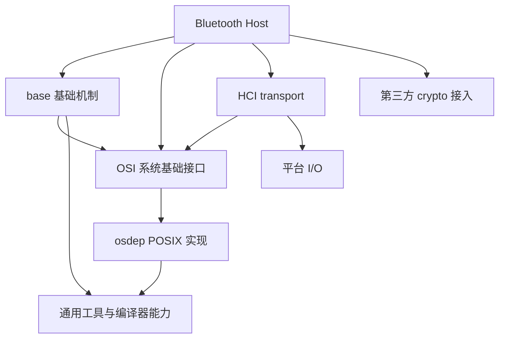

<!--
/****************************************************************************
 *  Copyright (C) 2026 EmBT contributors
 *
 * Licensed under the Apache License, Version 2.0 (the "License");
 * you may not use this file except in compliance with the License.
 * You may obtain a copy of the License at
 *
 *      http://www.apache.org/licenses/LICENSE-2.0
 *
 * Unless required by applicable law or agreed to in writing, software
 * distributed under the License is distributed on an "AS IS" BASIS,
 * WITHOUT WARRANTIES OR CONDITIONS OF ANY KIND, either express or implied.
 * See the License for the specific language governing permissions and
 * limitations under the License.
 ***************************************************************************/
-->

# EmBT 基础机制与 OSI 系统接口设计

最新状态：base、私有 atomic、net_buf pool 指针、显式初始化及三类 socket backend 已在本地实现。
当前落地结构和验证以 [编译适配 Review](BRINGUP_IMPLEMENTATION_REVIEW.md) 为准；以下布局与讨论保留设计背景。

状态：设计草稿。用户已认可基础机制与系统适配分离的方向；本文将其作为设计基线，
模块内部结构、OSI API、类型和实现细节继续逐项讨论。当前没有搬迁既有目录或修改协议栈源码。
OSI精简版内部声明和POSIX类型已在本地编写，详情见[接口草案](OSDEP_API_DESIGN.md)。
原demo已删除，全部OS模块后续使用cmocka验证，见[测试规划](OSDEP_TEST_PLAN.md)；函数后端已实现，本机结果见[测试结果](OSDEP_TEST_RESULTS.md)。

日期：2026-11-15。
首期目标：Linux/POSIX 上 Bluetooth 4.2 基础 LE 与 BR/EDR 编译/链接通过，不运行。
完整范围和源码阻塞见 [编译适配调研](BLUETOOTH_4_2_COMPILE_PORTING_STUDY.md)。

## 1. 两部分的定义

### 1.1 基础机制

基础机制定义 EmBT 自己维护的对象模型和行为：buffer、queue、pool、work/执行器、atomic、
内存策略和调试机制。它可以使用 OS 原语，但不能由某个平台的原生对象决定其全部语义。

例如，一个具有阻塞等待的 FIFO 由机制层定义节点、顺序、取出、取消等待等行为，
底层借用 OS 锁和等待能力；不能只映射成某个 RTOS 的原生 queue。

### 1.2 系统基础接口与实现

系统基础接口封装运行环境提供的能力：线程、同步、时钟、timer到期通知、等待/唤醒、系统内存和输出。
这组接口使用osi_函数前缀，类型保持os_*_t；头文件位于osdep/include/osi，供库内部使用。

OSI 当前只设计Linux/POSIX实现，负责本机差异、错误码转换、时间单位和对象生命周期。
它不负责 net_buf 的引用计数、queue 节点管理、work 状态机或 Bluetooth 事件处理。

函数名称不决定分层：第一阶段仍可保留 k_queue/k_fifo/k_work 等调用名称，
但它们属于机制；k_mutex/k_sem 等底层原语由系统基础实现提供。

## 2. 职责和依赖边界

| 内容 | 归属 | 负责的行为与边界 |
| --- | --- | --- |
| net_buf/buffer | base | 数据视图、headroom/tailroom、user data、引用计数、fragment、destroy与所有权 |
| pool/slab | base | 固定资源、空闲管理、容量、分配回收和统计；支持静态或外部提供的storage |
| queue/FIFO/LIFO | base | 节点、顺序、出入队、peek、取消和等待条件；借用OSI同步原语 |
| work/delayed work/执行器 | base | pending/running/cancel状态、任务提交、延迟、flush和执行上下文；组合OSI线程/等待/时钟 |
| atomic | base的基础工具 | 一套操作契约，优先编译器内建实现；不按POSIX/RTOS建立重复的上层API |
| 通用内存策略 | base | 决定池、arena或heap使用方式，提供配对分配/释放与必要统计 |
| thread、mutex、sem、condvar | OSI/osdep | 环境原语及创建、初始化、等待、退出、销毁契约 |
| clock、sleep、基础等待唤醒 | OSI/osdep | 单调时钟、休眠和唤醒能力；timeout表示和转换另行定义 |
| 系统timer到期通知 | OSI/osdep | 原生一次性create/start/stop/delete；callback只通知上层，delete不保证回调结束 |
| 逻辑timer与超时事件 | base | 业务超时状态、work/协议事件投递和执行上下文，组合OSI定时能力 |
| 系统heap来源 | OSI/osdep | alloc/free/aligned allocation的底层实现；POSIX可以使用libc |
| debug/assert/格式化 | base | 调试行为、断言和格式化；具体输出与fatal终止借用系统能力 |
| console/output/fatal能力 | OSI/osdep | 输出与终止的环境实现，不处理Bluetooth协议逻辑 |
| 纯算法/容器工具 | lib/基础头 | UUID、编码、字节序、纯list等相对独立工具；可被两层使用 |
| HCI transport | Bluetooth驱动 | HCI包、buffer所有权、driver配置、open/close/send与平台I/O |
| Mbed TLS及其他第三方适配 | third_party | 真实库配置、构建、分配hook与能力验证，不吸纳到OSI中 |



上图是允许的设计依赖方向，不是当前源码已经完成的分层。

依赖规则：

- base和Host依赖稳定的OSI契约；实现选择由构建确定。
- osdep不直接引用net_buf、work、FSM或Bluetooth状态。通知通过传入的callback/事件契约完成，
  不硬编码调用上层函数；回调通知不等于反向编译依赖。
- 两部分都能使用标准C、纯工具和编译器基础能力，不能因此产生对整套base运行机制的依赖。
- 机制的执行后端可以同时使用共用机制与OSI原语。此类组合属于执行机制管理，
  不能因为使用pthread/select就全部归为纯OSI实现。
- Header不能通过global.h式大聚合间接引入完整系统和协议状态；每个接口声明自己的类型和依赖。

## 3. 关键边界的设计结论

### 3.1 atomic与同步

atomic属于base内部基础工具，使用bt_atomic_*函数、bt_atomic_*类型及BT_ATOMIC_*宏。
内部header位于base/include/base/bt_atomic.h，不放到外部include/embt。底层使用GCC/Clang __atomic，
保留旧值、位操作、native long/指针宽度和内存序；详见[内部Atomic设计](ATOMIC_DESIGN.md)。
公开net_buf/L2CAP类型和inline helper中的atomic依赖必须一并处理，不能只隐藏include路径。

OSI锁实现内部可以使用编译器原语，但不依赖base的buffer/work/queue。其他编译器或
非内建实现的适配位置、是否允许非lock-free实现、ISR能力和目标ABI在OSI/atomic讨论时明确。
第一阶段保留真实同步，不能因长期单线程目标而将当前锁和atomic改为空操作。

### 3.2 内存策略、存储来源和buffer分开

有三个不同职责：

1. buffer维护数据和引用的语义。
2. pool/slab/arena管理给定storage中的资源。
3. heap来源提供系统级分配与释放能力。

固定pool可以直接使用静态数组或外部提供的storage，不需要每次调用malloc。
通用可变大小分配可使用独立arena或系统heap；固定池和arena不应混成一种资源模型。

对于系统来源，POSIX底层可以调用libc malloc/free，但EmBT上层使用有明确来源和释放配对的接口。
OSI对象的内部创建不反向调用net_buf/pool，以免出现“创建锁需要先使用受该锁保护的池”的
初始化依赖。具体采用调用方提供存储、平台自有分配还是opaque对象，留待OSI类型讨论。

Mbed TLS的分配hook与net_buf池分别管理。后续可以绑定相同的存储提供方，但不共享
各自对象的分配/释放语义，不全局替换malloc来掩盖来源。

### 3.3 queue与执行机制

纯linked queue只维护节点，可用于单线程内部。带阻塞/取消语义的queue是基础机制，
需要组合OSI同步能力；两者不能直接互相替代。

work负责任务状态和调用者契约，执行器负责在哪个上下文运行。平台执行后端负责将这些机制
连接到线程、时钟、等待/唤醒或平台I/O，属于base执行模块的实现选择。
内部目录可以按后续讨论组织为共用机制与backend，暂不固定文件布局。

长期方向：协议状态集中在单一执行上下文，跨线程/驱动入口投递事件后唤醒执行器。
第一阶段继续承接现有Zephyr work/thread契约；本次架构设计不提前实施单线程或全异步改造。

### 3.4 打印与调试

base管理最小打印、格式化、断言、必要统计及dump机制；OSI或宿主提供输出目的地与fatal行为。
可使用显式输出回调/接口绑定，避免把文件、UART或stdout策略固化在机制内部。

原 Zephyr logging 实现继续退役；保留 LOG_* 调用接口，采用内部 base/log.h 的轻量适配，
不在本阶段增加复杂异步logger；具体接口和缓冲策略另行讨论。

### 3.5 初始化与运行生命周期

静态storage与显式初始化可以共存。每个模块拥有自己的init/deinit和资源；
顶层组合入口安排依赖顺序及失败回滚，不能靠constructor、SYS_INIT或空section遍历启动对象。

模块初始化与运行启动有明确顺序：pool登记、对象初始化、driver配置登记不等于打开socket。
OSI线程create即允许运行，caller先完成依赖初始化；业务启动/停止条件由执行机制管理，
OSI不保存重复的gate、stop和状态机。transport open与资源清理仍由对应模块显式安排。
线程API沿用OpenBlue的create/start/cancel/join及身份/命名分组；POSIX start不延迟执行，
cancel只请求取消，后续仍需join及业务资源清理。
整库链接检查不调用无线启动入口；机制测试会单独执行基础初始化。

## 4. 目录设计

设计基线采用根目录base与osdep分开，不增加system父目录。

```text
base/
    net_buf/
    queue/
    pool/
    work/           共用work/执行机制及所需执行后端
    include/base/bt_atomic.h  内部compiler工具，待实现
    memory/
    debug/

osdep/
    include/osi/    内部契约头文件，不安装或向应用导出
    posix/          系统基础能力的POSIX实现
        include/osi/native_types.h

test/
    osdep/          已实现的cmocka测试

lib/
    utils/
    uuid/

bluetooth/
    ...             Host、协议、HCI驱动
third_party/
tools/
docs/
include/embt/
```

以上结构是目标布局；osdep内部头文件和POSIX类型已在本地建立，demo已删除；base机制已建立，net_buf仍保留在lib/net_buf，
现有net_buf实现仍位于lib/net_buf。对外Bluetooth公共头继续统一在include/embt。
OSI精简版位于osdep/include/osi，POSIX类型位于osdep/posix/include/osi；不再放在外部include中。
内部使用<osi/...>，CMake接入时仅向库内实现target提供路径，不向EmBT::embt消费者导出或安装。
OSI内部接口与应用公共接口的区别见[OSI API设计](OSDEP_API_DESIGN.md#2-内部目录和引用)。

port不作为当前OS层名称。未来确实需要板卡、transport、配置和入口程序的项目组合时，
可以单独引入port/ports；此类组合目录不承载所有基础机制和系统实现。

## 5. 参考源码与采用边界

| 项目 | 本次参考输入 |
| --- | --- |
| BTstack | /home/frozen/work/opensource/btstack，9edb5d82ea6ec4466a393415d65030929330acdf |
| Bluelet | /home/frozen/work/coding/fzw/code/bluelet/bluelet/src/stack，本地目录未提供Git版本；关键文件哈希另存于研究记录 |
| openblue | /home/frozen/work/opensource/stack_dev/openblue，3f8697c608a4b23cd59981a18f09e3d3838e0f72 |

| 参考内容 | 可借鉴的设计 | EmBT需要保持的边界 |
| --- | --- | --- |
| BTstack src/btstack_run_loop.c与platform/posix/btstack_run_loop_posix.c | 共用timer/data source/callback机制，加平台执行后端；跨线程投递使用mutex和pipe唤醒主循环 | 执行机制与基础OSI区分；其无锁容器不能直接替换当前阻塞queue |
| BTstack src/btstack_memory.c与btstack_memory_pool.c | 按对象类型配置固定数量pool或malloc策略，显式初始化storage | 保留net_buf自己的对象和引用契约，不直接改成BTstack packet buffer模型 |
| BTstack platform与port | platform提供可复用平台实现，port组织具体配置/芯片/transport与入口 | 当前osdep专注系统原语，避免引入宽泛组合目录 |
| Bluelet btcommon/buff.c、btmem.c、include/sysdep.h | buffer机制、静态arena分配策略与BTOS_NEW/FREE来源区分 | 固定pool与可变arena分别定义；系统对象分配避免反向依赖base |
| Bluelet btcommon/fsm.c与portings/btunix/unixdep.c | Timer_Expire把到期事件投递给ScheduleLoop，协议事件顺序消费 | Unix SIGEV_THREAD及可选RxLoop说明整套实现仍有多个执行上下文，不能直接当作单线程实现 |
| Bluelet btcommon/btdebug.c、BTstack hci_dump接口 | 通用调试与输出回调/实现分离 | 不继承大聚合头、旧logger兼容方式或未核对的实现细节 |
| openblue base与osdep | queue/work/buffer组合OS原语，已有Zephyr移植经验 | 重新核对timeout、返回码和生命周期，不复用空注册遍历或全局shim |

这里只采用设计思路，没有复制实现。参考研究没有编译或运行这些协议栈，
不能据此声称EmBT对应功能已验证。
BTstack/Bluelet关键源码路径与哈希记录在/tmp/embt-foundation-stack-comparison/evidence.json。

## 6. 构建与过渡要求

- base与osdep按明确的组件target管理，即使聚合到同一个libembt.a也保持源码归属与依赖清楚。
- POSIX的Threads和环境特性作用到对应target，不扩展为全局shim/preinclude。
- OSI头文件通过实现target的私有依赖提供；对外头文件不得要求应用提供OSI对象或内部include路径。
- 第一阶段保留必要k_*调用名称；kernel.h收敛为实际所需接口的过渡聚合入口，
  不复制完整Zephyr内核对象、scheduler/syscall/device机制。
- 原配置头引用迁到embt/autoconf.h，保留target -include；旧转发头在迁移后退役。
- 旧kernel/device/syscall依赖默认删除，仅保留实际直接使用的工具/类型依赖；协议同步逻辑保留。
- 本文确定功能归属；实际source split、target名称和directory移动在实现前核对，
  不因为定义base而删除非首期Bluetooth源码。
- 首期保持Bluetooth 4.2基础LE+BR编译范围，源码进入编译并完成完整链接检查；
  不使用空队列、假device、空注册或成功stub通过构建。

## 7. 下一轮OSI讨论顺序

当前先确认系统接口契约。[精简版声明与类型](OSDEP_API_DESIGN.md)已提供osi_内部接口，
不表示所有参数、属性或backend布局已经定稿。

| 顺序 | 讨论内容 | 需要形成的结果 |
| --- | --- | --- |
| O1 接口范围和分层 | 哪些是系统原语、哪些由base组合；哪些平台能力首期需要 | 最小OSI能力清单与明确排除项 |
| O2 对象类型和存储 | opaque handle、调用方storage或平台类型；静态分配与ABI要求 | 类型表示、header边界、存储所有权 |
| O3 生命周期和执行上下文 | init/create/start/stop/deinit；线程/ISR限制、回调在哪里执行 | 状态、调用方、初始化依赖与错误清理契约 |
| O4 timeout和错误结果 | NO_WAIT/FOREVER、单调时钟、精度/溢出、pthread/sem错误映射 | 一套时间和返回值规则，各接口保持实际语义 |
| O5 最小原语细节 | thread、mutex、sem、condvar、clock/sleep、timer | native类型、立即创建运行、阻塞join和timer参数寿命；不把queue/work合并进OSI |
| O6 memory/output扩展 | 系统分配来源、输出、fatal及实际需要的其他能力 | 可选能力、分配/释放配对和宿主绑定方式 |

O1-O4先决定共同规则，再逐类讨论O5/O6。基础机制内部API和buffer/work设计随后展开。
此顺序是讨论计划。osi_前缀和内部头文件位置已确认，join移除timeout；timer及对象语义已有
精简版草案。mutex/cond采用native别名，thread只存句柄，sem只加give锁及limit；
timer使用timer_t和callback/context，原生delete不提供callback drain。当前不开展FreeRTOS适配。

## 8. 文档状态与后续提交

本文记录系统设计。POSIX osdep已接入构建，base及基础协议配置的过渡机制已完成适配，禁用功能的剩余依赖尚未验收；
新OSI已提供声明和类型草案，POSIX功能后端和自动化测试已实现，协议栈接入仍未完成。
源码编译的真实证据与下一步改动范围见[编译适配调研](BLUETOOTH_4_2_COMPILE_PORTING_STUDY.md)。

文档在本地保留，收到明确提交指令后更新文档PR #2；实现按原代码/构建板块分别提交，
所有bring-up PR继续Draft、未合入，由人决定最终集成。
