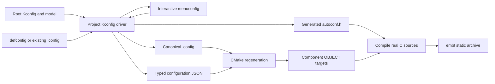
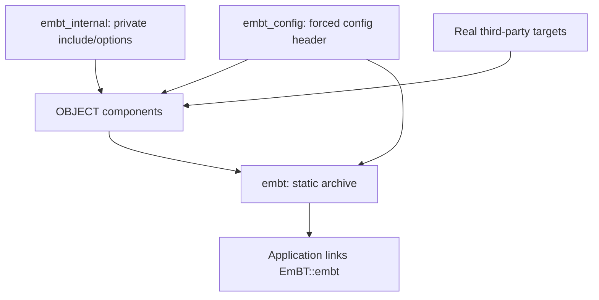

<!--
/****************************************************************************
 *  Copyright (C) 2026 EmBT contributors
 *
 * Licensed under the Apache License, Version 2.0 (the "License");
 * you may not use this file except in compliance with the License.
 * You may obtain a copy of the License at
 *
 *      http://www.apache.org/licenses/LICENSE-2.0
 *
 * Unless required by applicable law or agreed to in writing, software
 * distributed under the License is distributed on an "AS IS" BASIS,
 * WITHOUT WARRANTIES OR CONDITIONS OF ANY KIND, either express or implied.
 * See the License for the specific language governing permissions and
 * limitations under the License.
 ***************************************************************************/
-->

# EmBT 独立构建系统设计评估

状态：B0 构建系统已实现，通过独立构建Draft PR跟踪，未合入。menuconfig、configure/generate 和实际源码编译
入口已验证；协议栈仍因旧头引用失败。实际文件清单、验证日志和未完成工作以
[BUILD_SYSTEM_IMPLEMENTATION.md](BUILD_SYSTEM_IMPLEMENTATION.md) 为准。下文保留框架设计与接口约定。

旧Controller清理记录见 [CONTROLLER_CONFIG_CLEANUP.md](CONTROLLER_CONFIG_CLEANUP.md)，
最新根总开关/ABI清理见 [ABI_CONFIG_CLEANUP.md](ABI_CONFIG_CLEANUP.md)，密码库实际接入见
[CRYPTO_PROVIDER_DESIGN.md](CRYPTO_PROVIDER_DESIGN.md)。

## 1. 本轮目标与边界

第一轮构建目标是：真正打开 menuconfig，保存有效配置；CMake 完成配置和生成，然后调用
编译器处理实际 EmBT 源码。源码编译可以失败，但错误必须发生在实际源文件，而不是停在
未知 CMake 命令、缺少根入口、非法 Kconfig 或空目标。

这个目标不代表静态库已经编译完成、最终调用程序已链接或蓝牙运行基线已达成。当前已删除的
OS/平台/第三方集成和低关联头文件还需后续适配，不在这轮用成功返回值或空 provider 代替。

## 2. 研究输入与当前事实

| 输入 | 版本或事实 |
| --- | --- |
| 删除 logging 前的研究快照 | `1f8bcb583d899ecccacfa3feacf46ca862b43c62`，737 个文件 |
| Zephyr 来源 | `f8da8ea370508f274685a25ff19dbe5a9ff54790`，从保留 Git 历史读取原构建文件 |
| openblue 当前本地参考 | `207995445aee96900b861237218b7ec19b23e51e`，被读取的 tracked 文件无本地修改 |
| 既有 openblue 研究 | [OPENBLUE_REFERENCE.md](OPENBLUE_REFERENCE.md)，此前冻结到 `0012adc908c5d5217c320236c15739d141b2ba8e` |
| CMake / Ninja | 当前环境 3.28.3 / 1.11.1 |
| C 编译器 / Python | GCC 13.3.0 / Python 3.12.3 |
| 配置依赖 | 已安装 Kconfiglib 14.1.0、menuconfig 和 curses |
| 当前剩余构建文件 | 31 个 CMakeLists.txt、54 个组件 Kconfig 文件及新增根 Kconfig；旧日志入口已清理 |

### 2.1 当前实施状态

根 CMake/Kconfig、tools/cmake、统一配置 driver 与 mkbt.sh 已实现；未知 Zephyr 构建命令、
DT 默认函数和缺失配置类型等框架阻塞已处理。完整模型为 1010 个定义符号，解析无告警。

首期 11 个组件、51 个唯一 C 文件已生成编译任务。实际错误现位于 net_buf 的旧日志头、
Host/Classic 的旧 zephyr/ 引用等源码适配处。C 层日志清理、OS/provider/动态初始化仍未完成。

## 3. 总体框架



Kconfig 是配置语义的唯一求值来源。CMake 消费求值结果，构建脚本只调度命令，不再另写
一个 .config 解析器，也不把 CONFIG_* 作为 CMake cache 选项重复定义。

配置输出按 build directory 隔离；同一目录的 menuconfig、配置生成和编译共享同一份 .config。

## 4. Kconfig 工作范围

### 4.1 根入口及提供方（按本轮意见收敛）

通用缺失配置仍在根Kconfig，按menu/comment分组；按最新决定，Mbed TLS/PSA需求及库选项
集中维护在third_party/mbedtls/Kconfig，根通过rsource加载。
取消上一版 `config/Kconfig.platform`、`config/Kconfig.runtime`、
`config/Kconfig.dependencies` 三个拆分文件。已有 Bluetooth/lib/subsys 的定义和依赖保持在
原文件；根入口通过 `rsource` 加载它们，不把原有配置整体搬上来。

根文件顺序为：EMBT_STACK总开关 → ABI/构建属性 → 运行兼容参数 → 功能需求与未移植组件边界 → 现有各目录入口。
运行参数补齐类型、默认值、范围、help；不再给旧日志/backend 补定义，指定的 board/controller/MPU/USB 等标志直接删除；
剩余独立功能按实际消费者定义。PSA 算法等 `select` 项表达功能需求，不能据此声称库已找到。

第一轮保留未废弃的功能配置，BLE、BR/EDR 为基线，Mesh、LE Audio 和 shell 默认不选。
DEPRECATED 配置项和旧日志配置块直接删除，不以默认 n 的根定义继续保留。
有未移植实现的选项须在配置摘要中列出；已删除的 UART/RTT/Zephyr shell 后端入口应加明确
依赖或报不支持，不能仅靠 `default n` 阻止用户和 `select` 开启。

[配置迁移差异清单](KCONFIG_MIGRATION.md) 记录当前根定义、54 处实验标志改名、
8 个 deprecated 配置删除及日志配置清理。旧扫描计数不作为当前根定义任务。

#### 根菜单与协议栈总开关

根文件继续叫 `Kconfig`，使用 `mainmenu "EmBT Configuration"` 作为独立项目菜单标题。
`mainmenu` 不生成 CONFIG 宏，也不是功能开关。根文件承载公共配置定义和各目录入口；最外层 menuconfig EMBT_STACK包围整个树，
内部 EMBT只控制Bluetooth Host。总开关不依赖内部被包围的配置。

协议栈总开关保留在 `bluetooth/Kconfig`，把原 `menuconfig BT` 改为
`menuconfig EMBT`，提示文字为 `"EmBT Bluetooth Host"`；原 `depends on !SMP`、
`select NET_BUF` 保留。对应的 `if BT` 改为 `if EMBT`，闭合注释同步更名。
这是同一个开关的改名，不建立 EMBT select BT 的旧名称别名。

根入口的组织示意（省略根文件中的具体参数定义）：

```kconfig
mainmenu "EmBT Configuration"

menuconfig EMBT_STACK
	bool "EmBT stack"

if EMBT_STACK

# ABI, runtime and dependency definitions live here.
rsource "bluetooth/Kconfig.constants"
rsource "lib/Kconfig"
rsource "bluetooth/subsys/Kconfig"
rsource "bluetooth/drivers/Kconfig"
rsource "bluetooth/Kconfig"

endif # EMBT_STACK
```

Kconfig 允许前向引用，因此驱动配置可以先引用由 bluetooth/Kconfig 定义的 EMBT。
根入口不要用 `if EMBT` 包住包含 EMBT 自身定义的文件，这会使总开关依赖自身。
独立基线配置写 `CONFIG_EMBT=y`；若关闭它，menuconfig 仍可使用，独立构建 embt 库时
明确报告协议栈未启用，不用空静态库冒充成功。

总开关 BT/CONFIG_BT 改名为 EMBT/CONFIG_EMBT，保留 BT_CONN、BT_CLASSIC 等非日志子功能。
旧日志配置文件和模板整体清理，已撤销此前保留 module/parent-module BT 前缀及重命名日志
条件的方案。改名位置清单 K-08 只保留非日志修改点。

这能消除总开关 BT 的同名冲突，但 Kconfig 的符号是全局的，目录、menu、if 都不提供
命名空间隔离。如果未来与宿主系统的完整 Kconfig 树共用，还要处理 BT_* 和 LOG、SETTINGS
等保留的通用符号；LOG 属于废弃范围，不为它做名称迁移。外部集成时主菜单标题归宿主项目，独立根入口的
mainmenu 不应直接覆盖宿主标题，组件接入入口届时单独明确。

### 4.2 路径和宏

| 类别 | 当前情况 | 处理方向 |
| --- | --- | --- |
| 日志 source/rsource | 删除前有 107 处全局 source，另有相对入口 | 删除日志配置块和模板引用；目录内 1 处随目录删除，目录外 106 处已在本地清理 |
| UINT*/INT* 常量 | 当前 Kconfig.constants 提供边界变量 | 沿用 Kconfiglib 原生变量展开，不当作设备树宏删除 |
| module/parent/backend | 旧日志模板参数 | 随日志块和文件删除，保留其他用途的 Kconfig 原生变量展开 |
| dt_chosen_bool_prop | 1 处，BT_HAS_HCI_VS 的默认值 | 改为明确的 Host/HCI 配置语义，不实现返回 false 的通用 dt_* 替身 |
| 版本变量 | DIS 中 APP_VERSION_TWEAK_STRING/VERSION_MAJOR | 替换为根 EMBT_APP_VERSION；保留原 fallback，不填虚构版本 |
| ZEPHYR_TOOLCHAIN_VARIANT | 原日志中判断 xcc | 随 logging/Kconfig.misc 文件整体删除，本次已完成 |

Kconfiglib 原生支持 rsource、choice、select、depends on、变量展开等机制。保留这些机制
不需要重新实现 parser；自有脚本负责本项目的输入、诊断、生成和生命周期。

### 4.3 根定义的语义与需要特殊处理的项

| 分组 | 根/第三方配置入口的职责 | 注意事项 |
| --- | --- | --- |
| 运行接口参数 | workqueue 优先级/栈大小、`POLL` 等；不再定义 MULTITHREADING | 首期继续原线程/API 模型；参数存在不等于 POSIX 接口已经实现 |
| 目标与编译属性 | `EMBT_64BIT`、互斥大小端、优化/断言选择 | 目标 ABI 由配置明确选择，CMake 校验编译器；不得用宿主 Python 位数代表目标 |
| 旧平台/Controller 标志 | 直接删除指定的 Controller、board、MPU、USB/UART 标志 | 不保留隐藏 n 占位；Host 必要前提单独保留，硬件能力由运行期 HCI 确认 |
| 被 select 的功能需求 | `PSA_CRYPTO`、`PSA_WANT_*`、`PRINTK` | 需求可为 y，实际 provider 可仍缺失；构建摘要分别报告两者 |
| 可选外部实现 | `LIBSBC`、`LIBLC3`、shell/存储接口 | 按保留功能处理；旧日志及其后端的配置全部移除 |
| 实验功能标志 | `EMBT_EXPERIMENTAL` | 根定义隐藏 bool/default n；现存 54 处 select EXPERIMENTAL 精确改名，不保留旧别名 |
| 废弃配置 | 不提供 DEPRECATED 定义 | 删除 8 个已标记 deprecated 的完整配置项及其专用引用，保留受支持替代选项 |
| 旧日志配置 | 不提供 LOG/LOG_* 或模块日志定义 | 删除旧日志选项、模板和相关条件；不补 bool/default n 占位 |

`EXPERIMENTAL` 在本项目中统一改为 `EMBT_EXPERIMENTAL`，只改变符号名；菜单文案中的
`[EXPERIMENTAL]` 可以保留。当前 13 个文件有 54 处 select，逐文件位置见迁移清单第 3 节。

K-10 删除完整 deprecated 配置，不是仅去掉 `select DEPRECATED`：包括 BT_CUSTOM、
BT_SIGNING、BT_MESH_MODEL_VND_MSG_CID_FORCE、4 个旧 GATT writable 别名以及旧 RING_BUFFER
兼容开关。GATT 当前 BT_* 替代项和安全默认值保持，RING_BUFFER_LARGE 等独立项保持。
K-04 直接删除 LOG/LOG_* 相关 Kconfig，先前的日志候选和兼容定义建议不再作为实施输入。

根参数的两个约定：

- 不定义 MODULES；仅对 Kconfiglib 无引用的内建解析对象作识别，真实依赖缺失仍报错，m 仍不支持。
- `SYSTEM_WORKQUEUE_PRIORITY` 不是未定义，而是仅在 `bluetooth/Kconfig` 附加 range。
  根入口补 `int/default -1`；保留原 cooperative range，不能用 0 规避类型问题。

设备树仅剩一个 Kconfig 函数调用：删除 `bluetooth/common/Kconfig` 的 `ZEPHYR_BT_HCI`
辅助变量及 DT default；保留 `BT_HAS_HCI_VS` 原定义/help，在根 Kconfig 补
`config BT_HAS_HCI_VS` 的 `default n`。普通 Linux HCI 控制器不自动宣称支持 Zephyr 私有命令，
已知需要此能力的设备再通过显式配置接入。此处修改不自动清除 C 代码中的 DT/设备初始化。

所有具体位置、前后表达式、根新增项以及宏保留项见差异清单；保留数值常量和非日志配置的原生
Kconfig 展开，不引入“未知函数统一返回 false”的兼容层。

### 4.4 单次求值与输出

自有 tools/kconfig/configure.py 使用 Kconfiglib：

1. 初次创建目录时加载 defconfig 和明确给出的 fragments；已有 .config 则加载已有用户选择。
2. menuconfig 调用真实交互界面，保存后重新求值。
3. 从同一个 Kconfig 对象生成 build-dir/.config、generated/include/embt/autoconf.h、kconfig/config.json 和已读取 Kconfig/fragment 文件清单；同时生成旧路径 zephyr/autoconf.h 的转发头，不重复生成配置值。
4. 比较内容后原子替换生成文件，避免仅因重跑脚本改变时间戳；输出含配置摘要便于核对。

C 头文件中 bool y 为 1、bool n 不定义；int/hex/string 按实际类型生成。CMake 从 JSON 读取
类型和值，bool 统一映射 ON/OFF。字符串通过数据读取，避免拼成可执行 CMake 或 shell 代码。

模型语法、未知函数、未定义/无类型符号、非法范围和有意义的配置冲突须明确报告。依赖不满足
导致用户选择被改变时报告原因。menuconfig 非交互或失败必须返回非零，不静默写默认配置。

清理目标只清对象和生成构建产物；保留 .config。改变 profile、重置配置使用明确 defconfig
操作，不能在每次 build 时重放 defconfig 覆盖菜单修改。

### 4.5 配置头自动进入构建

统一文件名为 `autoconf.h`，由构建目录保存，例如
`build/posix/generated/include/embt/autoconf.h`。它不是源码树文件，也不需要开发者手动生成。

1. CMake configure 阶段、任何 `if(CONFIG_*)` 之前调用 Python driver，生成头文件和 typed JSON。
2. 新建 `embt_config` INTERFACE target，通过 GCC/Clang 的 `-include <绝对头文件路径>` 强制
   在源文件之前加载配置；仅作用于 C/C++，按一个带引号的参数组传递，兼容路径中的空格。
3. 每个 EmBT OBJECT 组件 PRIVATE 链接 `embt_config`；最终 `embt` PUBLIC 链接它。
   因公共头文件包含 CONFIG 条件，消费方通过 `EmBT::embt` 获得同一配置，不必手工 include。
   第三方库自身不链接此 target，也不获得 EmBT 的 CONFIG 宏和私有编译选项。
4. **保留已有 108 处 `#include <zephyr/autoconf.h>`，不删除、不改名。** 自动注入与显式
   include 可以并存；已有引用位置清单改作保留检查清单，新代码不必额外添加配置头 include。
5. 在同一构建目录生成 `generated/include/zephyr/autoconf.h` 转发头，并通过 `embt_config`
   导出 `generated/include` 搜索路径。转发头引用同目录树下唯一的 embt/autoconf.h；不另生成
   一份 CONFIG 值，不在源码树创建兼容头，也不为其他旧 zephyr/ 路径建立通用映射。
6. 主配置头和转发头使用 include guard；强制加载后再显式 include 不重复定义配置。
   两个头均作为配置产物参与重配置依赖，GCC/Clang depfile 跟踪实际包含关系。
   菜单改值后先更新编译图和头文件，再重编相关对象；任一生成头缺失都从现有 .config 恢复。

保留 `#include` 仍要求其文件路径真实存在，`-include` 本身不会跳过源码中的 include 指令。
因此旧路径转发头是保留现有引用所需的构建产物；这项兼容不恢复已经废弃的 logging 接口。

target 设置示意（已由配置模块实现）：

```cmake
add_library(embt_config INTERFACE)
target_include_directories(embt_config INTERFACE
  "${EMBT_GENERATED_INCLUDE_DIR}")
target_compile_options(embt_config INTERFACE
  "$<$<COMPILE_LANGUAGE:C,CXX>:SHELL:-include \"${EMBT_AUTOCONF_HEADER}\">")
target_link_libraries(embt_host PRIVATE embt_config)
target_link_libraries(embt PUBLIC embt_config)
```

不同时生成一套 `-DCONFIG_*=...`；这样不会出现宏值双写、n 被定义为 0 而破坏 `#ifdef`
语义、字符串经命令行重复转义的问题。配置头使用 include guard。直接手写 gcc 调用的使用者
必须使用等价的 -include 和生成头 include 搜索路径；首期交付的是 CMake build-tree target，
安装/export/SDK 打包另行设计。

## 5. CMake 函数和 target 设计

### 5.0 对上一版框架的评估

| 上一版选择 | 本轮结论与补充 |
| --- | --- |
| OBJECT 组件 + 最终 STATIC 库 | 保留；每个源文件只编译一次，并让库的依赖通过 CMake target 传递 |
| INTERFACE 仅传 usage requirements | 保留；配置头是公共编译要求，蓝牙内部 include 和 warning/优化参数是私有要求 |
| helper 自动归属当前组件 | 显式 `embt_library(name)`，查目录自身 property；子目录不能误用父目录组件 |
| 每个目录直接创建组件 | 收紧：纯分发目录不建 target，完全可选的源码组在非空时才创建组件 |
| CMake 读取 typed JSON | 保留；所有 CONFIG 值是普通作用域变量，不进 cache，未知 bool 条件不静默变 n |
| 配置生成加在 build target 前 | 必须提前到 configure 阶段；仅用 add_dependencies 无法及时改变源文件图 |
| 全局源码归集或 INTERFACE_SOURCES | 不采用；容易让 consumer 再编译一次源码，并扩散编译选项 |
| 缺 provider 后再处理 | 明确 B0 只搭真实编译图并报告缺口；不创建空库或用成功日志代替编译/链接 |

### 5.1 当前使用量

删除日志前的 32 个 CMakeLists.txt 共调用 287 次扩展，分属 12 类；当前剩余 31 个文件。
迁移清单排除已删除日志组件，需要按语义迁移，不导入原 Zephyr
272 KB 的 extensions.cmake，也不定义同名 zephyr_* wrapper 留住原入口。

| 原命令 | 新处理 |
| --- | --- |
| zephyr_library | embt_library，创建明确的组件 OBJECT target |
| zephyr_library_sources / _ifdef | embt_library_sources / _ifdef，源码归属于当前组件 |
| zephyr_sources / _ifdef | 给对应目录显式建立组件，统一到 embt_library_sources；不保留隐式全局源码池 |
| zephyr_library_include_directories / _ifdef | embt_library_include_directories / _ifdef，PRIVATE include 默认只作用于当前组件 |
| zephyr_library_link_libraries / _ifdef | embt_library_link_libraries / _ifdef，通过标准 target_link_libraries 传递真实依赖 |
| zephyr_include_directories | 项目内部 include 放到专用 usage target，公共 include 放到最终 embt target |
| add_subdirectory_ifdef | embt_add_subdirectory_ifdef，条件来自已解析配置 |
| zephyr_library_property(ALLOW_EMPTY TRUE) | 无源码父目录改为分发目录，仅在有选中源码的子目录创建 OBJECT target |

仅增加当前使用到的 helper。必要内部函数包括当前组件查找、布尔配置读取和最终 target 聚合；
其余直接使用标准 target_*，不建立覆盖整个 CMake 的第二套 API。

### 5.2 源码所有权

组件通过 DIRECTORY property 保存当前 target，不能从父目录错误继承另一个组件的 target。
构建前要求显式 embt_library 声明。源码路径规范化为绝对路径，以路径而不是 basename 去重：
同一组件重复选择同一文件只编译一次；不同组件重复拥有同一文件视为设计错误。

OBJECT target 编译组件源文件，最终 embt STATIC target 直接链接这些对象组件，形成一个
libembt.a；对外暴露 EmBT::embt。组件的 PRIVATE flags 不传给应用或第三方库，公共 ABI/
头文件要求由最终公共 target 提供。第三方 target 保持自己的编译选项。

不创建用于证明“进入编译”的 dummy C 文件，也不创建空 provider 或带 INTERFACE_SOURCES
的源码 target。INTERFACE target 仅承载必要 include/编译 usage requirements。

### 5.3 条件函数

embt_config_enabled 读取配置模型中明确声明的 bool。未定义符号、意外类型或 unsupported m
不得作为 false/y 悄悄处理。源文件缺失、没有当前组件、被启用依赖缺少 target 都给出直接诊断。

旧 mbedtls_iface、TF-M/native_sim 链接逻辑收敛为本项目的真实依赖接口。第一轮配置/菜单不
进行隐式联网下载；Mbed TLS adapter已实现显式固定source准备和真实库查找。首轮区分源码编译需求与 provider 的链接
可用性，不挂尚不存在的 provider target，也不生成空 target 代替实际库。真实源文件编译自然
报告未接入的头文件/接口；已声明接入却缺少 target 的情况作为设计错误直接报告。

B0 的基线必须先保证菜单、配置和编译图完整，使首次失败发生在实际源码阶段；完整依赖和
最终链接能力在后续接入阶段验证。这个阶段边界需要在实现时通过真实编译日志证明。

### 5.4 重配置

根 CMake 在生成 target 图之前执行配置求值，并读取 typed JSON。使用 CMAKE_CONFIGURE_DEPENDS
跟踪 .config、全部实际读取的 Kconfig、fragments 和生成器。菜单保存改变配置后，下一次构建
必须先重新生成 target 图，源文件选择与 autoconf 同步。

menuconfig 也可直接由脚本运行，避免要求完整第三方/编译环境先通过配置才能打开菜单。
CMake 中同名 custom target 使用 USES_TERMINAL/VERBATIM，调用同一个 Python driver。

### 5.5 根 CMake 的执行顺序

根入口固定以下顺序，不让源码目录自行执行配置生成或搜索 Python：

1. `cmake_minimum_required(VERSION 3.20)`、拒绝 in-source build、`project(EmBT LANGUAGES C)`。
   工具链选择走标准 `CMAKE_TOOLCHAIN_FILE` / `CMAKE_C_COMPILER`；不使用 west 或 Zephyr SDK。
2. 找 Python 3.10+、检查固定 Kconfiglib 依赖；读取构建目录和 defconfig 参数。
3. 执行 `embt_configure()`，取得 .config、JSON、头文件及模型文件列表。
4. 按 JSON 类型导入普通 `CONFIG_*` 变量，校验编译器指针ABI/字节序与根配置一致，不设置具体架构名单。
   首期Linux GCC/Clang；配置与编译器指针位宽或字节序不一致时直接报错，不暗改配置。
5. 创建 `embt_config`、内部 usage target、最终 `embt` STATIC 和 `EmBT::embt` ALIAS。
6. 调用第三方需求报告/已接入 provider 发现，遍历 lib、Bluetooth 支撑层、驱动和协议目录。
7. 汇总注册的 OBJECT targets，检查非空和源码归属，通过
   `target_link_libraries(embt PRIVATE <object-targets>)` 聚合。
8. 添加 menuconfig/olddefconfig/savedefconfig target，输出配置摘要、缺失 provider 及选中组件。
   启用 `CMAKE_EXPORT_COMPILE_COMMANDS`，供核对真实源文件和编译参数。

根路径以 EmBT 自身入口保存的绝对路径为准，函数不要假定 `CMAKE_SOURCE_DIR` 一定指向 EmBT。
首期先验证独立构建；消费示例只用于验证 `EmBT::embt` 的配置传播和静态链接行为。

### 5.6 target 的责任与依赖方向



箭头表示提供构建要求或产物；第三方库的头文件/链接要求可传给使用它的组件，但反向不接受
EmBT 的强制配置头或编译选项。

| target/组件 | 源码及作用 | 可见性/首期处理 |
| --- | --- | --- |
| `embt_config` | 强制配置头和生成头搜索路径；支持旧显式 include，无源文件 | 组件 PRIVATE、最终库 PUBLIC |
| `embt_internal` | include 根、bluetooth 内部路径、GNU C11、EmBT 自有 warning/优化策略 | 组件 PRIVATE；不加全局 CFLAGS |
| `embt_common` | bluetooth/common | 根据原 source list 迁移；common/dummy.c 是上游文件，不作为验收证据 |
| `embt_host` / `embt_classic` | bluetooth/host、host/classic | BLE/BR 核心；BT_CONN 与 BT_ISO 同时选中 conn.c 时只编译一次 |
| `embt_crypto` / `embt_bt_lib` | bluetooth/crypto、bluetooth/lib | 记录 PSA/SBC 需求；不保留 mbedtls_iface/TF-M 链接桥 |
| `embt_services` 及各服务组件 | services 根源码和 bas/ots 等子目录 | 全可选组先判断源码是否非空，各源只归一个 target |
| `embt_net_buf` / `embt_utils` / `embt_uuid` | 根 lib 下三个目录 | 替代旧全局 zephyr_sources，UUID 未启用时无空目标 |
| `embt_crc` / `embt_settings` / `embt_random` | bluetooth/subsys 保留项 | 显式配置条件；原 logging 废弃，不创建 embt_logging 组件 |
| `embt_hci_userchan` | 两个现存 userchan 源文件 | hci 子目录独立拥有源码；父 drivers 仅分发；native_sim/DT 仍待移植 |
| Mesh/audio/shell 组件 | 原非 Controller 蓝牙文件 | 保留文件与条件；基线关闭；统一迁移构建命令但不开展功能适配 |
| `embt` | 聚合 OBJECT 产物到 libembt.a，提供 `EmBT::embt` | PUBLIC 仅公共 include/配置要求；真实 provider 链接依赖须传到消费方 |

不同时使用 `target_link_libraries(embt ... object-target)` 和 `$<TARGET_OBJECTS:...>` 重复
聚合同一批对象。也不把 provider 的对象复制进 EmBT；静态库的外部链接需求应保留在 target
依赖图中。注册表限定为当前 EmBT 构建实例，首期不设计多个不同配置实例共存。

静态库归档不会主动保留最终链接中的所有注册段/未被引用对象。后续动态初始化需显式调用
入口并用真实应用验证；这轮不能通过添加全局 whole-archive 假定旧静态初始化已解决。

### 5.7 最小函数合同

| 函数签名 | 行为及错误处理 |
| --- | --- |
| `embt_library(name)` | 创建 OBJECT target，关联当前目录并注册；重复 name 或同目录重复声明报错 |
| `embt_library_sources(files...)` | 当前组件 PRIVATE sources；规范化绝对路径、检查存在；组件内去重、跨组件冲突报错 |
| `embt_library_sources_ifdef(CONFIG_X files...)` | 严格检查符号存在且为 bool，再添加源码 |
| `embt_library_include_directories(paths...)` / `_ifdef` | 仅当前组件 PRIVATE include；无组件报错，不创建隐式 target |
| `embt_library_link_libraries(targets...)` / `_ifdef` | PRIVATE 使用真实 target；传入不存在的 target 报错，避免误当 -lxxx |
| `embt_add_subdirectory_ifdef(CONFIG_X dir)` | 同一配置结果控制目录选择；保留 CMake 原生 add_subdirectory 行为 |
| `embt_config_enabled(CONFIG_X out)` | 查询类型和 ON/OFF 值；非 bool、缺符号、m 均报错 |
| `embt_configure()` | configure 阶段调用唯一配置 driver，并向调用方导出求值结果/产物路径 |
| `embt_finalize_library()` | 检查组件和源码所有权，聚合至最终 embt；无真实源码报错 |

目录显式声明示意：

```cmake
embt_library(embt_host)
embt_library_sources(uuid.c addr.c buf.c data.c hci_core.c hci_common.c id.c)
embt_library_sources_ifdef(CONFIG_BT_CONN conn.c l2cap.c att.c gatt.c)
embt_library_sources_ifdef(CONFIG_BT_ISO iso.c conn.c)
embt_add_subdirectory_ifdef(CONFIG_BT_CLASSIC classic)
```

这只是源文件归属示意，落地保留原 `CONFIG_BT_HCI_HOST`、安全、角色和 raw HCI 分支，不能
直接用上面几行替换完整 Host 清单。对 services/lib 等全可选组，先用配置构造源码列表，再
在列表非空时声明 target；不复制 ALLOW_EMPTY 或添加空 C 文件。少量复杂 OR/AND 条件仍用
原生 `if()`，加载配置时完成符号校验，不为每种组合增加 helper。

### 5.8 JSON、依赖与增量构建合同

JSON 至少包含 schema version、配置摘要、每个符号的 name/type/value、实际读取文件列表，
以及初始 defconfig/fragment 的来源记录。bool 全量导出，包括 n；不把“没有出现在 .config”
当作未知符号。CMake 用 `string(JSON ...)` 读取，不生成再 `include()` 一段可执行的配置脚本。

| 事件 | 必须发生的动作 |
| --- | --- |
| 首次 configure | 无 .config 时合并指定基线/片段，生成全部产物，再决定 source list |
| 普通重复 build | .config 已存在，不重放 defconfig；内容不变时不触碰头文件时间戳 |
| menuconfig 保存 | driver 重新求值并写产物；下一次 ninja/CMake build 先重新 configure，再编译 |
| menuconfig 取消 | 有配置时保留原值；首次初始化和用户保存动作分别报告，UI 失败返回非零 |
| 原 Kconfig/driver 改变 | 重新解析；保留仍合法的用户值，报告被约束改变的值 |
| 改动初始 defconfig | 保留已有 .config；摘要提示基线变化，显式 defconfig 操作才重新加载 |
| 主配置头、旧路径转发头或 JSON 被删除 | 构建系统先触发 configure，按现有 .config 补产物，不能先编译再报头文件不存在 |
| 配置项从 y 改 n | 新 header 不再定义该宏，source graph 和依赖清单同步取消选中源码 |
| 配置失败 | driver 非零，CMake 终止，不使用上一份头文件继续构建 |
| 同时配置同一目录 | 配置 driver 用构建目录内锁串行化写入；不支持边菜单改配置边并行编译同一目录 |

`CMAKE_CONFIGURE_DEPENDS` 跟踪 .config、实际加载模型/driver/片段和配置产物；原子替换时仅写
变更内容。不能同时定义另一条独立 build-time 规则生成同一份头文件和 JSON；否则可能在旧
source graph 下生成新头文件。CMake/Ninja 对菜单后重配置、产物删除的具体行为需用验收确认。

ABI配置使用根菜单的 EMBT_64BIT与 EMBT_LITTLE_ENDIAN/EMBT_BIG_ENDIAN，CMake校验编译器位宽与字节序。工具链特性没有
验证时使用保守默认值；若 VLA 等候选仅被旧日志引用则取消其根定义计划；不为打开菜单强制执行编译器探测。

### 5.9 第三方与首轮失败的含义

需求与实现分开报告，PSA目前已接入单一Mbed TLS；SYSTEM/SOURCE/EXTERNAL及能力检查
见 [CRYPTO_PROVIDER_DESIGN.md](CRYPTO_PROVIDER_DESIGN.md)。B0 允许已知的 POSIX、
HCI userchan接口仍未完成，仍生成真实协议源文件编译图，错误可发生在头文件/API 阶段。
原 `MBEDTLS_BUILTIN` 条件和 `mbedtls_iface`/TF-M 注入按差异清单迁移，不恢复 modules。

接入 third_party 后，只在找到真实库时建立 provider target 并传递 include/link requirements；
不得通过创建空同名 target 或给所有密码学依赖加 n 来伪造闭环。完整构建阶段缺少请求的
provider 要明确失败。首期的“进入真实 C 编译”和后续的“完整构建/链接”使用不同验收结果，
不增加一个默默屏蔽错误的脚本开关。

## 6. 需要增加和修改的文件

以下职责已在本地实现，具体文件和验证状态见实施文档。

自有 CMake 模块统一放在 `tools/cmake/`，与 `tools/kconfig/` 并列。根 `CMakeLists.txt`
仍保留为标准 CMake 入口，`mkbt.sh` 保留在根目录；各源码目录的 CMakeLists.txt 继续就近
描述源码列表。只把公共构建框架放进 tools，不把所有 CMakeLists.txt 搬进去。

```text
EmBT/
├── CMakeLists.txt
├── Kconfig
├── mkbt.sh
├── config/
│   └── posix_host_defconfig
├── tools/
│   ├── cmake/
│   │   ├── embt_library.cmake
│   │   ├── embt_kconfig.cmake
│   │   └── embt_dependencies.cmake
│   ├── kconfig/
│   │   └── configure.py
│   └── requirements-build.txt
└── bluetooth/
    ├── CMakeLists.txt
    └── Kconfig
```

根 CMake 用 EmBT 自身入口路径加载 `tools/cmake/` 模块；模块查找同级工具时基于其自身
list directory 或显式的 EMBT 根路径，不依赖调用者 cwd，也不保留根 cmake/ 的兼容副本。

| 文件 | 职责 |
| --- | --- |
| CMakeLists.txt | 项目、C 编译器、配置生成、内部 usage target、组件入口、最终 embt 库 |
| Kconfig | 项目根菜单、集中补齐缺失定义/类型/默认值、现有配置入口 |
| tools/cmake/embt_library.cmake | 最小组件/source/条件/依赖 helper 和聚合 |
| tools/cmake/embt_kconfig.cmake | 调用配置 driver、读取 JSON、生成依赖、菜单 target |
| tools/cmake/embt_dependencies.cmake | B0 需求/可用性报告，后续接真实 provider；第一轮不扩展为包管理器 |
| config/posix_host_defconfig | BLE + BR/EDR 的第一轮基线选择，不给无实现功能假造能力 |
| tools/kconfig/configure.py | 自有配置、菜单、olddefconfig、savedefconfig 驱动 |
| tools/requirements-build.txt | 固定 Kconfiglib 版本，外部依赖显式安装 |
| mkbt.sh | 薄命令入口：menuconfig/configure/build/clean/defconfig/olddefconfig/savedefconfig |
| .gitignore | 排除 build、虚拟环境和生成文件 |
| 剩余 31 个 CMakeLists.txt | 替换扩展命令、明确源码 target、整理原库/目录引用 |
| 剩余 Kconfig | 删除所有旧日志配置与入口，处理 DT/版本默认值及保留功能依赖 |
| 108 处现有配置头 include | 保留原行，不产生源码改动；由自动注入、生成头搜索路径和旧路径转发头支持 |
| build-dir/generated/include 下两个配置头 | driver 自动生成 embt/autoconf.h 和 zephyr/autoconf.h 转发头，不提交到 Git |
| K-08 列出的 4 个现有文件 | 总开关 BT → EMBT 的 6 个非日志修改点；日志条件随文件删除 |

parser 和 menu UI 使用固定版本的 Kconfiglib，本项目实现控制脚本。不会恢复已删除的 Zephyr
scripts/modules 目录，也不在 CMake configure 中自动 pip install。当前机器依赖已安装。

## 7. 命令接口建议

以下命令已可使用；build 当前会返回实际源码编译失败：

```sh
./mkbt.sh menuconfig --build-dir build/posix --defconfig config/posix_host_defconfig
./mkbt.sh configure --build-dir build/posix
./mkbt.sh build --build-dir build/posix -j 8
./mkbt.sh clean --build-dir build/posix
./mkbt.sh defconfig --build-dir build/posix --defconfig config/posix_host_defconfig
./mkbt.sh olddefconfig --build-dir build/posix
./mkbt.sh savedefconfig --build-dir build/posix --output /tmp/embt-local_defconfig

cmake -S . -B build/posix -G Ninja -DEMBT_DEFCONFIG=config/posix_host_defconfig
cmake --build build/posix --target menuconfig
cmake --build build/posix --target embt --parallel 8
```

mkbt.sh 定位项目根，可靠转发路径和参数，保留真实退出码。menuconfig 的 Python/curses/终端
错误直接报告；编译失败也直接返回失败，不继续输出“构建成功”。build directory 可隔离多个配置。

建议初始基线使用 CMake >= 3.20、Python >= 3.10 和 Kconfiglib 14.1.0；生成器先支持 Ninja。
新工具的最低版本和系统包安装命令在实施阶段验证，不要求复用 Zephyr SDK/west。

### 7.1 mkbt.sh 的调用合同

| 动作 | 调度内容 | 对已有配置的处理 |
| --- | --- | --- |
| 无动作或 `build` | 自动完成首次 configure，再 `cmake --build ... --target embt`，转发 -j/--verbose | 保留 .config，自动处理源文件图更新 |
| `configure` | `cmake -S <项目根> -B <build-dir> -G Ninja` | .config 不存在才用 defconfig 初始化 |
| `menuconfig` | 直接调用同一个 Python driver 的菜单模式；不要求 CMake/compiler/provider 先通过 | 保存/取消含义与真实 UI 一致；退出后下次 build 重配置 |
| `olddefconfig` | 按当前模型重算已有配置并生成产物 | 新符号取合法默认值；已有值改变须报告；缺少 .config 则明确报错 |
| `defconfig` | 明确重置命令，加载指定 defconfig/fragment，先保留原 .config.old | 只有这个动作替换已有菜单选择；不再追加隐含确认流程 |
| `savedefconfig` | 用 Kconfiglib 导出最小选择到显式 --output | 不覆盖现有 .config；输出已存在时要求显式 --force |
| `clean` | 调用 CMake clean，只清编译产物 | 保留 .config；不删除用户指定的整个目录 |

默认 build-dir 为项目下 `build/posix`，默认初始配置为 `config/posix_host_defconfig`。
从任意 cwd 调用时，相对 build-dir/defconfig/fragment 路径统一按 EmBT 根解释；绝对路径原样
使用，savedefconfig 的相对 output 也按 EmBT 根解释。帮助文本明确这一规则。

`--fragment <file>` 可重复，按命令给出的顺序覆盖初始 defconfig；仅初始化/显式重置加载。
已有 .config 时重新传不同基线/fragment 组合应报“请使用 defconfig 重置”，不能静默忽略
用户本次指定的不同输入，也不能每次 build 重放旧片段。配置来源和有序片段清单保存在
build-dir 的 kconfig/config.json；仅 source 内容改变时按 5.8 的规则提示。

脚本只做参数校验和命令调度：不解析 CONFIG、不生成头、不搜索源码、不复制库文件；使用
Bash 数组传参，不拼 eval。未识别动作/选项返回非零，保留 Python/CMake/Ninja 真实退出码。
Python 依赖缺失时给出 `python3 -m pip install -r tools/requirements-build.txt` 的说明，
由用户选择安装环境，脚本不自动安装。menuconfig 要验证 TTY/TERM/curses；失败不得写默认
配置后伪装成功。configure-only 不宣称编译成功，build 的首个真实错误要保留在输出中。

### 7.2 第一轮基线选择

`posix_host_defconfig` 明确选择 EMBT、Host、BLE central/peripheral、BR/EDR、NET_BUF 和
BT_USERCHAN，保留默认安全/密码学需求；Mesh、LE Audio、shell、未接入的额外 codec 不选。
撤销 PRINTK + LOG_MODE_MINIMAL 日志方案；PRINTK 的非日志用户另行核定，settings 后端未接入前不
宣称有持久化。根参数沿用兼容多线程需求；mkbt.sh 不开启单线程或全异步重构。

配置摘要区分“已选功能/要求的接口”和“已找到的实现”，例如 PSA_CRYPTO=y 与 provider 状态。
这些选值是实施输入，menuconfig/配置求值后的实际值和原因仍需记录，不能用 defconfig 原文
代替求值结果。全量候选/逐行迁移以 [KCONFIG_MIGRATION.md](KCONFIG_MIGRATION.md) 为准。

## 8. 实施顺序与验收

| 阶段 | 工作 | 验收 |
| --- | --- | --- |
| B0.1 配置模型和菜单 | 根 Kconfig、相对路径、特殊默认值、typed 提供方和 driver | 无未处理模型错误；真实打开菜单、修改、保存、重新加载 |
| B0.2 编译图 | 根 CMake、最小 helper、组件声明和命令替换 | configure/generate 完成；编译器处理实际 host/common/net_buf 等源码 |
| B0.3 配置闭环与脚本 | mkbt.sh、菜单 target、JSON/header 输出和自动重配置 | 改菜单后源码集合和头文件同时更新，开关从 y 改 n 不残留旧值 |
| 后续源码/运行适配 | embt/ 引用、生成接口、POSIX、provider 和动态注册 | 分别完成编译、静态库、调用程序链接及最终蓝牙运行验证 |

关键检查包括：

- bool n 不生成宏；int/hex/string 与实际配置一致；未定义/非法配置失败有明确原因。
- 菜单可真实交互，非 TTY 不被替代为默认配置写入；不存在配置时只按明确基线初始化。
- 每个选中源文件有一个编译 owner，关闭模块后源文件消失；不把同名不同路径文件误去重。
- 配置、头文件、编译命令来自同一结果；不必每次手动 clean 才能让选项生效。
- compiler command 和日志必须包含真实 EmBT C 文件，不能把编译器 ABI 检测或临时 demo 作为进入协议栈编译的证据。
- 已知的旧 zephyr/ 引用、已删 DT/OS 接口可以在第一轮成为真实源码错误；后续独立适配。
- 静态库完成后仍需真实调用程序验证未解析符号和动态注册路径，不能只凭归档成功认定能运行。

## 9. 验证结果

已完成真实 PTY 菜单（脚本与 CMake target）、保存/取消、源码图增量、配置持久化、
生成头/JSON 恢复、配置类型和错误输入验证。组件 helper 通过去重、归属冲突、依赖和
编译选项隔离检查。实际协议 C 文件已进入编译，仍因源码移植缺口失败。

原始日志及脚本在 /tmp/embt-build-implementation/；完整结果、运行环境及边界见
[BUILD_SYSTEM_IMPLEMENTATION.md](BUILD_SYSTEM_IMPLEMENTATION.md)。未执行蓝牙硬件运行验证。

## 10. 逐项差异与实施记录

详细清单独立放在 [KCONFIG_MIGRATION.md](KCONFIG_MIGRATION.md)，便于逐项 review：

- 根 Kconfig 的缺失定义/类型/默认值及原引用位置。
- 唯一 DT 函数、旧版本/工具链变量的删除或替换。
- 旧日志文件、配置、宏和模板入口的废弃范围；旧相对路径迁移方案已撤销。
- 108 处现有 autoconf include 的保留位置和旧路径生成头要求。
- 配置层已能解析不等于 C 源码所有 CONFIG_*、设备/OS 接口均已补齐。

构建框架与 mkbt.sh 已实现，通过独立构建Draft PR跟踪；旧日志 C 调用、命名空间、POSIX与运行初始化
按后续阶段推进。文档与代码后续仍按原规则分别提交。
